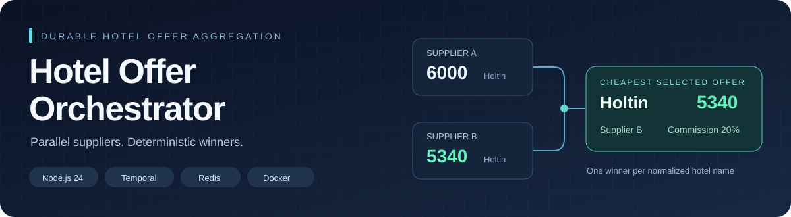
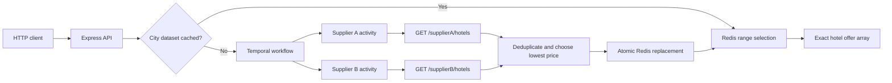
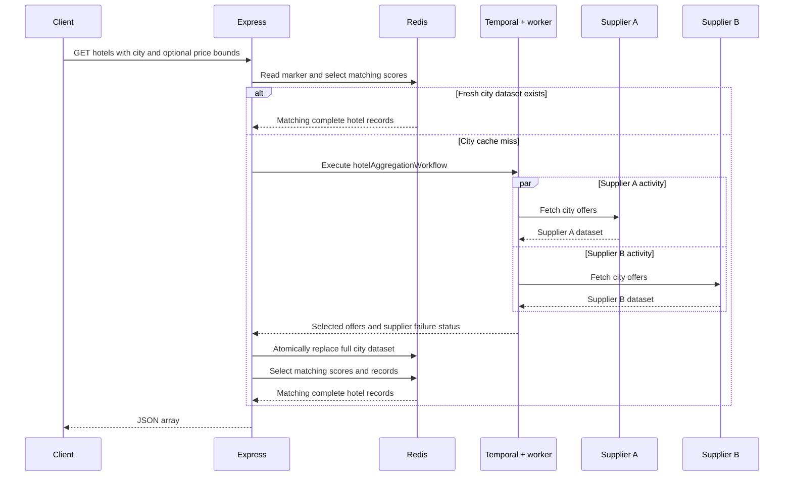

<p align="center">
  
</p>

<p align="center">
  <a href="https://github.com/Aditya-112/hotel-offer-orchestrator/actions/workflows/ci.yml"></a>
  <a href="https://github.com/Aditya-112/hotel-offer-orchestrator/actions/workflows/docker-publish.yml"></a>
  
  
  
  
  
</p>

<p align="center">
  <strong>Fetch independently. Compare by price. Filter where the data lives.</strong><br />
  A backend assessment project with durable Temporal orchestration, atomic Redis caching, and server-side price selection.
</p>

<p align="center">
  <a href="#quick-start">Quick start</a> ·
  <a href="#architecture">Architecture</a> ·
  <a href="#api-reference">API reference</a> ·
  <a href="#test-it-yourself">Try it</a> ·
  <a href="#docker-hub-distribution">Docker images</a> ·
  <a href="#verification">Verification</a>
</p>

---

## What this project does

One request turns two supplier datasets into one predictable list of hotel offers. Temporal coordinates supplier HTTP activities in parallel. A pure comparison function keeps the cheapest valid offer for each normalized hotel name. Redis stores the full selected dataset and performs inclusive price-range queries on the server.

| Capability | How it is implemented |
| --- | --- |
| Concurrent supplier calls | Temporal activities scheduled with `Promise.allSettled` |
| Correct hotel comparison | Trimmed, case-insensitive identity; lowest price wins |
| Durable orchestration | Separate Temporal client, workflow, activities and worker |
| Real Redis filtering | Sorted-set scores + `ZRANGEBYSCORE` + selected `HGET` records |
| Consistent cache updates | Atomic Lua replacement and atomic range reads |
| Useful failure behavior | Independent bounded retries, partial results and explicit service errors |
| Observable execution | Temporal UI, dependency health and Pino correlation logs |
| Reproducible execution | Multi-stage Docker images, Compose, Postman and real integration tests |

The application uses Node.js 24, TypeScript, Express 5, Temporal, Redis, Zod, Pino and Vitest. It has no frontend, authentication layer, or additional application database. Prices use one assumed currency; the API does not perform currency conversion.

## Quick start

### Run the complete stack from source

Install Docker Engine or Docker Desktop with Compose v2. Then:

```bash
git clone https://github.com/Aditya-112/hotel-offer-orchestrator.git
cd hotel-offer-orchestrator
docker compose up --build --wait --wait-timeout 180
```

Node.js is not required on the host for this path. Compose starts Redis, Temporal, the API and the worker, initializes the Temporal namespace, and waits for actual service readiness.

```bash
curl http://localhost:3000/health
curl 'http://localhost:3000/api/hotels?city=delhi&minPrice=5000&maxPrice=6000'
```

| Local address | Purpose |
| --- | --- |
| `http://localhost:3000/api/hotels?city=delhi` | Aggregated offers |
| `http://localhost:3000/health` | Detailed dependency health |
| `http://localhost:3000/live` | API process liveness |
| `http://localhost:8233` | Temporal workflow dashboard |

> Already running the native development processes? Stop them first, or set different host ports in `.env`, so Docker can bind its ports.

### Stop and restart

```bash
docker compose stop
docker compose start
docker compose down
```

`stop` stops containers. `down` removes containers and the Compose network while preserving the named Redis and Temporal volumes. **`docker compose down --volumes` deletes this stack's local stored state.** Cache TTLs continue to expire normally.

## Architecture



The API submits workflows to the configured Temporal namespace and task queue. The separate worker registers workflows and activities and executes the tasks. Both deterministic mock supplier routes are served by the API; the activities call them over HTTP, including when running on the Compose network.

Workflow code receives its city and timeout/retry settings as input. It does not read environment variables or perform HTTP or Redis I/O. Activities own supplier networking. The API service owns cache persistence and response transport.

### Cache miss versus cache hit



Temporal supplies independent activity retries, deadlines and execution history. Redis sorted sets supply indexed numeric range selection. A first filtered request still caches the complete deduplicated city dataset before asking Redis for the requested range.

## API reference

### `GET /api/hotels`

| Query parameter | Required | Rules |
| --- | --- | --- |
| `city` | Yes | Trimmed, whitespace normalized and lowercased; 1–80 characters |
| `minPrice` | No | Finite, nonnegative decimal; inclusive lower bound |
| `maxPrice` | No | Finite, nonnegative decimal; inclusive upper bound |

City names start with a Unicode letter and may contain letters, spaces, apostrophes, periods or hyphens. Repeated city or price parameters are rejected. Empty bounds, hexadecimal notation, negative values, NaN and infinity are rejected. `minPrice > maxPrice` returns 400. Either price bound can be used alone.

The successful response is always an array with these exact fields:

```json
[
  { "name": "Holtin", "price": 5340, "supplier": "Supplier B", "commissionPct": 20 },
  { "name": "Radison", "price": 5900, "supplier": "Supplier A", "commissionPct": 13 }
]
```

This is the exact result for Delhi with `minPrice=5000&maxPrice=6000`. There is no metadata wrapper. No matching offers returns `[]`.

### Supplier endpoints

| Route | Description |
| --- | --- |
| `GET /supplierA/hotels` | Supplier A's complete deterministic dataset |
| `GET /supplierB/hotels` | Supplier B's complete deterministic dataset |
| Either route with `?city=delhi` | That supplier's offers for the normalized city |

Supplier records include `hotelId`, `name`, `price`, `city` and `commissionPct`. The datasets are independent, contain overlapping and supplier-exclusive hotels, and include an equal-price overlap.

### Fixture cities and expected results

| City | Selected hotels | Behavior |
| --- | ---: | --- |
| `delhi` | 5 | Shared hotels, unique hotels and equal-price tie |
| `mumbai` | 3 | Second independently cached city |
| `jaipur` | 0 | Valid city with no offers |
| Other valid names, such as `atlantis` | 0 | Successful empty dataset |

Delhi's complete selected list is:

| Hotel | Price | Supplier | Commission |
| --- | ---: | --- | ---: |
| Lotus Residency | 3800 | Supplier B | 15% |
| City Garden | 4500 | Supplier A | 11% |
| Holtin | 5340 | Supplier B | 20% |
| Radison | 5900 | Supplier A | 13% |
| The Imperial | 12500 | Supplier A | 12% |

## Test it yourself

Start the stack first, then use these requests in a browser, Postman or a terminal:

| Check | Request | Expected result |
| --- | --- | --- |
| Complete Delhi dataset | `/api/hotels?city=delhi` | Five offers, sorted by price |
| Both bounds | `/api/hotels?city=delhi&minPrice=5000&maxPrice=6000` | Holtin and Radison |
| Minimum only | `/api/hotels?city=delhi&minPrice=6000` | The Imperial |
| Maximum only | `/api/hotels?city=delhi&maxPrice=4500` | Lotus Residency and City Garden |
| Exact inclusive boundary | `/api/hotels?city=delhi&minPrice=4500&maxPrice=4500` | City Garden |
| No matching prices | `/api/hotels?city=delhi&minPrice=1&maxPrice=2` | `[]` |
| Empty city | `/api/hotels?city=jaipur` | `[]` |
| Missing city | `/api/hotels` | 400, `INVALID_CITY` |
| Reversed bounds | `/api/hotels?city=delhi&minPrice=6000&maxPrice=5000` | 400, `INVALID_PRICE_RANGE` |

```bash
curl -i 'http://localhost:3000/api/hotels?city=delhi'
curl -i 'http://localhost:3000/api/hotels?city=delhi&minPrice=5000&maxPrice=6000'
curl -i 'http://localhost:3000/api/hotels?city=mumbai'
curl -i 'http://localhost:3000/api/hotels'
```

In the Temporal UI, open the `default` namespace and inspect completed `hotelAggregationWorkflow` executions. Open an execution's event history to inspect supplier activity attempts. A request served from the fresh Redis cache does not create another workflow; the default complete cache TTL is 60 seconds.

### Postman

Import [`postman/hotel-offer-orchestrator.postman_collection.json`](postman/hotel-offer-orchestrator.postman_collection.json). Set the collection variable `baseUrl` to `http://localhost:3000`, then run the collection against a healthy stack.

The collection includes **15 requests and 33 assertions** for winning offers, supplier commissions, exact response fields, unique names, price boundaries, validation errors and dependency health. `npm run postman:validate` checks the official v2.1 schema. `npm run postman:test` executes this collection's HTTP requests and assertion scripts through Chai and a focused `pm` adapter; it is not a complete Postman runtime.

## Hotel selection rules

1. Validate supplier payloads, including their requested city, price and commission.
2. Normalize hotel identity with `name.trim().toLowerCase()`.
3. Retain the offer with the lowest price for each identity.
4. Resolve equal prices by supplier name, favoring Supplier A. Same-supplier ties use ordinal display name and then smaller commission.
5. Preserve the winner's trimmed display name, price, supplier and commission.
6. Sort by price ascending, then normalized name using ordinal comparison.

Internal spaces and punctuation are preserved. `Sea View`, `SeaView` and `Sea  View` are separate identities. Commission does not override a lower hotel price. The final tie rules make output independent of supplier and offer ordering.

A malformed HTTP supplier dataset is rejected as a nonretryable supplier failure. The pure aggregation function also excludes invalid individual offers when called directly.

## Redis storage and filtering

```text
hotels:{delhi}:prices    sorted set    normalized name → winning price
hotels:{delhi}:offers    hash          normalized name → complete offer JSON
hotels:{delhi}:ready     string        complete | partial
```

The encoded city makes keys city-specific. The shared hash tag keeps a city's structures in one Redis cluster slot. The normalized hotel name is the stable identifier in both the index and hash.

**Writes:** one Lua script removes the old dataset, writes its replacement, and sets matching expiry deadlines. Redis runs the script atomically, preventing readers from observing interleaved writes. Smaller replacements remove stale index entries. The marker exists even for empty datasets, distinguishing a cached empty city from a miss.

**Reads:** another Lua script checks the marker, executes `ZRANGEBYSCORE` using inclusive bounds, then performs `HGET` only for selected IDs. Selection and hydration share an atomic read, preventing a concurrent refresh from mixing versions. Node.js validates and sorts the returned matches; price selection happens in Redis. Request processing does not use `KEYS` or load the full hash to filter it in JavaScript.

| Cache state | Default TTL | Behavior |
| --- | ---: | --- |
| Complete dataset | 60 seconds | Reuse until expiry |
| Partial supplier result | 10 seconds | Refresh sooner after supplier recovery |
| Empty successful city | 60 seconds | Marker prevents unnecessary repeated workflows |
| Cache miss | — | Fetch and save a full deduplicated dataset before selection |
| Redis unavailable | — | Explicit 503; no misleading fallback |

Concurrent misses for a city share one refresh inside the API process. Multiple API replicas can refresh independently; the last completed refresh wins. Expiry is the automatic invalidation mechanism.

Inspect the real index and winning record:

```bash
docker compose exec redis redis-cli ZRANGEBYSCORE 'hotels:{delhi}:prices' 5000 6000 WITHSCORES
docker compose exec redis redis-cli HGET 'hotels:{delhi}:offers' holtin
```

Invalidate the entire city together:

```bash
docker compose exec redis redis-cli DEL 'hotels:{delhi}:prices' 'hotels:{delhi}:offers' 'hotels:{delhi}:ready'
```

## Reliability and failure handling

### Retry and deadline budget

| Setting | Default | Purpose |
| --- | ---: | --- |
| Supplier HTTP timeout | 1500 ms | Abort stalled network requests |
| Activity start-to-close | 3000 ms | Bound one activity execution |
| Activity schedule-to-close | 12000 ms | Bound queue delays and all activity attempts |
| Activity maximum attempts | 3 | Limit each supplier independently |
| Initial / maximum retry delay | 250 / 1000 ms | Exponential backoff with coefficient 2 |
| Workflow execution timeout | 20000 ms | Bound the overall orchestration |
| Dependency probe timeout | 1500 ms | Keep health and worker checks bounded |

There is no additional HTTP retry layer and no workflow retry policy. The Temporal client also applies an RPC deadline. Startup validation checks the timeout relationships and cache TTL ordering.

### Partial results policy

| Supplier outcome | API outcome |
| --- | --- |
| Both succeed | Complete selected dataset, including a valid empty list |
| One fails; the other returns offers | 200 with survivor offers, short TTL, `x-hotel-data-status: partial` |
| One fails; the successful supplier is empty | Service error; no empty dataset is fabricated or cached |
| Both unavailable | 502 after bounded activity retries |
| Stalled suppliers leave no usable dataset | 504 |
| Worker, Temporal or Redis unavailable | Controlled 503 |

### Error contract

```json
{
  "error": {
    "code": "INVALID_PRICE_RANGE",
    "message": "minPrice must not exceed maxPrice.",
    "requestId": "example-request-id"
  }
}
```

| Status | Error codes |
| --- | --- |
| 400 | `INVALID_CITY`, `INVALID_MIN_PRICE`, `INVALID_MAX_PRICE`, `INVALID_PRICE_RANGE` |
| 404 | `NOT_FOUND` |
| 502 | `SUPPLIER_UNAVAILABLE` |
| 503 | `REDIS_UNAVAILABLE`, `TEMPORAL_UNAVAILABLE`, `WORKER_UNAVAILABLE` |
| 504 | `SUPPLIER_TIMEOUT` |
| 500 | `INTERNAL_ERROR` |

Responses omit stack traces, credentials and infrastructure addresses. Every response has `x-request-id`; valid incoming IDs are propagated to activities and structured logs.

## Health, logs and failure exercises

`GET /health` probes both real supplier endpoints, Redis `PING`, the Temporal namespace and worker readiness concurrently:

```json
{
  "status": "healthy",
  "checks": {
    "api": true,
    "supplierA": true,
    "supplierB": true,
    "redis": true,
    "temporal": true,
    "worker": true
  }
}
```

| State | HTTP status | Meaning |
| --- | ---: | --- |
| `healthy` | 200 | Every check passes |
| `degraded` | 200 | One supplier fails while core dependencies work |
| `unhealthy` | 503 | Both suppliers fail, or a core dependency fails |

`GET /live` checks only API process liveness. Worker readiness is served internally on port 3002. The API rejects cache misses while the worker is unavailable; fresh cached results remain usable.

```bash
docker compose logs -f api worker
docker compose ps
```

Pino logs include request IDs, methods, paths, statuses, elapsed request times, supplier attempts and cache refresh outcomes. API shutdown drains requests and closes clients. Temporal drains worker activities with a bounded grace period. The application image runs as the nonroot `node` user.

<details>
<summary><strong>Exercise a supplier outage</strong></summary>

Invalidate the city first, then change one mock supplier's mode:

```bash
docker compose exec redis redis-cli DEL 'hotels:{mumbai}:prices' 'hotels:{mumbai}:offers' 'hotels:{mumbai}:ready'
SUPPLIER_A_MODE=unavailable docker compose up -d --force-recreate api
curl -i 'http://localhost:3000/api/hotels?city=mumbai'
curl http://localhost:3000/health
```

Expect a partial 200 response and degraded health. Set a supplier to `timeout` to simulate a stalled request. Set both modes to `unavailable` to exercise a 502 after retry exhaustion. These modes are environment-driven; there is no public toggle endpoint.

Restore healthy behavior:

```bash
SUPPLIER_A_MODE=healthy SUPPLIER_B_MODE=healthy docker compose up -d --force-recreate api
```

Fresh caches intentionally keep their data until expiry. Invalidate a city or wait for its TTL when checking a mode change.

</details>

## Configuration and local development

See [`.env.example`](.env.example) for all settings and [`src/config/env.ts`](src/config/env.ts) for startup validation. No credentials are needed for the local assessment stack. Keep real `.env` files outside Git.

| Configuration group | Main variables |
| --- | --- |
| API and logging | `NODE_ENV`, `PORT`, `LOG_LEVEL` |
| Redis and freshness | `REDIS_URL`, `CACHE_TTL_SECONDS`, `PARTIAL_CACHE_TTL_SECONDS` |
| Temporal routing | `TEMPORAL_ADDRESS`, `TEMPORAL_NAMESPACE`, `TEMPORAL_TASK_QUEUE` |
| Supplier networking | `SUPPLIER_A_URL`, `SUPPLIER_B_URL`, `SUPPLIER_HTTP_TIMEOUT_MS` |
| Activity retry budget | `ACTIVITY_START_TO_CLOSE_MS`, `ACTIVITY_SCHEDULE_TO_CLOSE_MS`, `ACTIVITY_MAX_ATTEMPTS`, `ACTIVITY_RETRY_INITIAL_MS`, `ACTIVITY_RETRY_MAX_MS` |
| Workflow and health | `WORKFLOW_TIMEOUT_MS`, `DEPENDENCY_TIMEOUT_MS`, `WORKER_HEALTH_URL`, `WORKER_HEALTH_PORT` |
| Mock failure modes | `SUPPLIER_A_MODE`, `SUPPLIER_B_MODE` |
| Compose host ports | `API_PORT`, `REDIS_PORT`, `TEMPORAL_PORT`, `TEMPORAL_UI_PORT` |

Compose reads `.env` automatically and supplies container service addresses explicitly. Inside containers the API uses port 3000 and connects through `redis:6379`, `temporal:7233` and `worker:3002`. Use host port overrides to resolve conflicts; container routing remains unchanged.

### Develop with Node.js 24

```bash
npm ci
cp .env.example .env
docker compose up -d redis temporal
node --env-file=.env --import tsx src/server.ts
```

In a second terminal:

```bash
node --env-file=.env --import tsx src/temporal/worker.ts
```

`npm run dev` and `npm run dev:worker` use watch mode and default settings; export environment overrides in those terminals. Local processes load `.env` only when explicitly passed `--env-file`.

For development without Docker, start a local `redis-server` and `temporal server start-dev`, then run the same Node processes.

## Verification

| Command | What it verifies |
| --- | --- |
| `npm run typecheck` | Strict TypeScript contracts |
| `npm run lint` | Typed lint rules |
| `npm test` | Aggregation, validation, HTTP contracts and cache-service behavior |
| `npm run test:integration` | Real Redis, real Temporal, real HTTP suppliers and Express |
| `npm run test:process` | Separate compiled API/worker processes and collection assertions |
| `npm run build` | Production compilation |
| `npm run postman:validate` | Official Postman v2.1 collection schema |
| `npm run postman:test` | Live HTTP collection against a running healthy stack |
| `npm run check` | Type checking, lint, unit/API tests, build and schema validation |

Integration and process tests need `redis-server` on PATH. The Temporal testing SDK downloads its CLI on first use. Set `REDIS_SERVER_PATH` and `TEMPORAL_CLI_PATH` to existing binaries for other installations or offline use. Tests own isolated ephemeral instances and do not flush a shared Redis service.

**Observed verification:** the [recorded Linux CI run](https://github.com/Aditya-112/hotel-offer-orchestrator/actions/runs/45038411486) passed 53 unit/API tests, 24 real integration tests, Docker image builds, all four container health checks, and 15 Postman requests with 33 assertions. See the [verification record](docs/verification.md) and [requirement audit](docs/requirements-audit.md) for evidence and limits.

Coverage includes an arrival barrier proving parallel supplier execution, actual retry call counts, HTTP and Temporal activity timeouts, partial and total failures, disconnected clients, city isolation, empty-city markers, matching expiry deadlines, atomic smaller replacements and graceful SIGTERM. Redis slow-log evidence confirms `ZRANGEBYSCORE` and `HGET` execute on the server, without `HGETALL`.

## Docker Hub distribution

The shared application image runs either the API or worker, depending on its start command. The Temporal image adds a writable nonroot data directory to the pinned official CLI image. Redis uses its official image.

| Image | Purpose |
| --- | --- |
| [`aditya40hehe/hotel-offer-orchestrator`](https://hub.docker.com/r/aditya40hehe/hotel-offer-orchestrator) | API and Temporal activity worker |
| [`aditya40hehe/hotel-offer-orchestrator-temporal`](https://hub.docker.com/r/aditya40hehe/hotel-offer-orchestrator-temporal) | Assessment Temporal server with persistent volume directory |
| `redis:7.4.7-alpine` | City cache and price index |

The manual [`publish-docker` workflow](.github/workflows/docker-publish.yml) runs the complete verification workflow before publication. It builds Linux AMD64 and ARM64 images, publishes `latest` and commit-specific `sha-<full-commit>` tags, then pulls the published images into a new Compose stack and runs the collection again.

**Published and verified:** the [Docker Hub publication run](https://github.com/Aditya-112/hotel-offer-orchestrator/actions/runs/45041514869) passed. Both images are public and support `linux/amd64` and `linux/arm64`. A fresh Linux AMD64 runner pulled the commit-specific images anonymously, brought all four containers to healthy status, and passed 15 HTTP requests with 33 assertions. Native ARM64 container execution was not separately tested.

Run the published images without building source:

```bash
docker compose -f docker-compose.hub.yml up --pull always --no-build --wait --wait-timeout 180
```

Use `IMAGE_TAG=sha-<full-commit>` to pin both custom images to a release, or `DOCKERHUB_NAMESPACE` to use another authorized namespace. With this file, use `docker compose -f docker-compose.hub.yml` for subsequent logs, stop and down commands as well.

For maintainers, set repository variable `DOCKERHUB_USERNAME` and repository secret `DOCKERHUB_TOKEN` with permission to push to that namespace. Tokens belong in GitHub Actions secrets, never in the repository. Publishing requires a manual workflow dispatch and does not run on pull requests.

## Project structure

```text
hotel-offer-orchestrator/
├── src/
│   ├── app.ts                         Express routes and centralized errors
│   ├── server.ts                      API startup and graceful shutdown
│   ├── service.ts                     Cache orchestration and request coalescing
│   ├── config/env.ts                  Validated environment configuration
│   ├── domain/hotels.ts               Schemas and pure comparison function
│   ├── http/                          Validation, health and error contracts
│   ├── redis/cache.ts                 Atomic Lua storage and range reads
│   ├── suppliers/data.ts              Independent deterministic supplier fixtures
│   └── temporal/                      Client, workflow, activities and worker
├── tests/
│   ├── unit/                          Aggregation, HTTP and service tests
│   └── integration/system.test.ts     Real Redis/Temporal/HTTP integration
├── postman/                           Collection and official validation schema
├── scripts/                           Health, collection and process smoke tools
├── docker/temporal.Dockerfile         Nonroot Temporal data directory
├── docs/                              Verification, requirement audit and banner
├── .github/workflows/                 Verification and manual Docker publication
├── Dockerfile                         Shared multi-stage application image
├── docker-compose.yml                 Build and run from source
├── docker-compose.hub.yml             Pull and run registry images
└── .env.example                       Documented defaults
```

## Deployment scope and tradeoffs

The included [Temporal CLI development server](https://docs.temporal.io/cli/setup-cli) uses embedded SQLite on a named volume. It is appropriate for a local assessment and needs no separate persistence service. Its directory is created with the Temporal service user's ownership before Docker initializes the volume.

An external deployment needs the API, worker, Redis and a supported Temporal service. Keep the same namespace and task queue across API and worker; configure supplier addresses and worker readiness through environment variables. The worker's internal readiness port must be reachable by the API. The image can be started with `node dist/server.js` or `node dist/temporal/worker.js`.

For production, configure managed or properly self-hosted Temporal, Redis, TLS and secret injection. This repository does not provision that infrastructure or implement Temporal Cloud authentication. Publishing to Docker Hub distributes images; it does not create a public hosted API endpoint.

Reasonable future work includes distributed refresh coalescing for multiple API replicas, supplier payload-size limits, pagination for larger datasets, metrics and authenticated production dependency connections.

## Troubleshooting

| Symptom | Action |
| --- | --- |
| `docker` command missing | Install and start Docker Desktop or Docker Engine with Compose v2 |
| Port already allocated | Stop the existing process or override the relevant host port in `.env` |
| API returns 503 during startup | Check `/health` and `docker compose logs api worker temporal redis` |
| Worker is unavailable | Verify Temporal address, namespace, task queue and worker readiness routing |
| Temporal UI has no new workflow | A fresh cache hit reuses Redis for 60 seconds; check the UI's namespace and time filter |
| Failure mode seems ineffective | Invalidate the city's three keys or wait for its TTL |
| Redis is unavailable | Check `docker compose exec redis redis-cli ping`, volume permissions and logs |
| Temporal cannot open its database | Check persistent-volume permissions and Temporal logs |
| Integration tests cannot find Redis | Install `redis-server` or set `REDIS_SERVER_PATH` |
| Temporal CLI cannot download | Set `TEMPORAL_CLI_PATH` to an existing compatible binary |
| Docker Hub pull fails | Check that publishing succeeded, the namespace/tag exists and private image access is authorized |

The detailed requirement mapping, submission checklist and PDF-verification limitation are recorded in [docs/requirements-audit.md](docs/requirements-audit.md).
